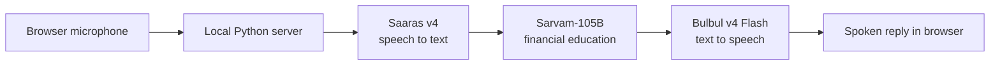

# Money Guide

**A voice-first financial education assistant built with Sarvam AI.** Ask a question about budgeting, loan terms, or investing basics, and get a spoken response in a simple browser experience.

> This is an educational demo. It does not provide personalized investment recommendations or guarantee loan eligibility, rates, or returns.

## What it does

- Records up to 25 seconds from your browser microphone.
- Transcribes speech with Saaras v4, generates a conversational response with Sarvam-105B, and speaks it with Bulbul v4 Flash.
- Keeps a short conversation history so follow-up questions have context.
- Runs a lightweight Python server using the standard library; `sarvamai` is the only project dependency.
- Keeps the Sarvam API key on the server and out of browser code.

## How a voice turn works



The app uses short, press-to-talk turns. It is not a continuous live-streaming conversation.

## Run locally

You need Python 3.8 or newer and a Sarvam API key.

### Windows PowerShell

```powershell
python -m venv .venv
.\.venv\Scripts\Activate.ps1
python -m pip install -r requirements.txt
Copy-Item .env.example .env
```

Open `.env`, set `SARVAM_API_KEY=your_key`, then start the app:

```powershell
python web_app.py
```

Open <http://127.0.0.1:8000>, allow microphone access, and press **Start speaking**. Press **Stop & send** when you’re done. Press `Ctrl+C` in PowerShell to stop the server.

### macOS or Linux

```bash
python3 -m venv .venv
source .venv/bin/activate
python -m pip install -r requirements.txt
cp .env.example .env
```

Add your key to `.env`, run `python web_app.py`, and open <http://127.0.0.1:8000>.

## Financial guidance boundaries

Money Guide can explain financial concepts, help organize a budget, and calculate illustrative loan examples from figures you provide. It states assumptions and treats loan terms as estimates until confirmed by a lender.

Investment responses are educational: the assistant avoids personalized security or fund picks and does not promise outcomes. It asks for a country before discussing jurisdiction-specific rules. Do not share passwords, account numbers, or identification numbers.

Voice clips and conversation turns are sent to Sarvam to provide the service. The local server does not write request content to its logs. Review Sarvam’s data practices before using this demo with sensitive information.

## Project files

| File | Purpose |
| --- | --- |
| `web_app.py` | Local server and Sarvam API orchestration |
| `index.html` | Responsive voice interface |
| `sarvam_chat.py` | Minimal command-line chat call |
| `requirements.txt` | Python dependency |
| `.env.example` | Environment variable template |
